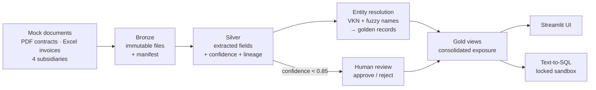

# CS491 Exploration Project

A small, runnable mock of the **IDP → Data Lakehouse → GenBI** platform described in
[`docs/CS491_Keşif_Raporu.pdf`](docs/CS491_Keşif_Raporu.pdf): a system for multi-subsidiary
holdings and banks that turns scattered contracts and invoices into one consolidated,
traceable counterparty-risk view.

This is an **early exploration**, not the real platform. Every layer from the report exists in a
naive form so the architecture can be seen, clicked through and questioned. Each heavy component is
swapped for the lightest tool that teaches the same lesson. All data is **synthetic**; there are no
real company documents.

> Full background, design decisions and roadmap: [`docs/PROJECT_CONTEXT.md`](docs/PROJECT_CONTEXT.md)

## What it demonstrates



| Report layer | Report stack | Stand-in here |
|---|---|---|
| Ingestion / orchestration | Dagster, Airbyte | `python -m mock491 …` CLI |
| Bronze lake | MinIO / S3 | Content-addressed files under `data/bronze/` |
| Silver / Gold | PostgreSQL + Iceberg, dbt | DuckDB file + plain SQL views |
| Parsing / extraction | Docling, OCR, LLM + Instructor | `pdfplumber` + rule-based extractor behind Pydantic schemas |
| Entity resolution | Splink | VKN (tax ID) checksum + `rapidfuzz` name matching |
| Human-in-the-loop | Custom review screen | Review queue page (0.85 confidence threshold) |
| BI / GenBI | Superset, LangGraph, Next.js | Streamlit multipage app + Text-to-SQL box |

**Highlights**

- **Lineage end to end:** every number traces back to its source file, page and bounding box. The
  UI renders the original PDF page with the clause highlighted, or the spreadsheet row it came from.
- **Golden records:** one company written five different ways across four subsidiaries becomes a
  single counterparty with consolidated exposure.
- **Human review:** low-confidence extractions (missing or invalid VKN, unclear amounts) wait in a
  queue. Nothing reaches the gold numbers until a person approves it.
- **Ask the data:** plain-language questions (English or Turkish) become SQL. The SQL always runs in
  a locked, in-memory sandbox scoped to the selected subsidiary, so the model never touches the
  warehouse or sees the data.
- **Measured, not assumed:** `evaluate` scores extraction and resolution against the generator's
  ground truth.

## Quick start

Requires Python 3.12+.

```powershell
python -m venv .mock491_venv
.\.mock491_venv\Scripts\Activate.ps1          # macOS/Linux: source .mock491_venv/bin/activate
pip install -e ".[dev]"

python -m mock491 init                        # create the warehouse + gold views
python -m mock491 generate                    # synthetic documents -> data/mock
python -m mock491 ingest data/mock --by-folder
python -m mock491 extract
python -m mock491 resolve

streamlit run app/main.py                     # http://localhost:8501, run from the project root
```

`data/` is generated locally and is not part of the repository.

## The UI

| Page | What it shows |
|---|---|
| **Overview** | KPIs, exposure by counterparty and subsidiary, items waiting for review |
| **Counterparties** | Searchable golden records, every source document and every spelling of the name |
| **Ask the data** | Text-to-SQL: question → SQL → table and chart, with the SQL always visible |
| **Review queue** | Low-confidence extractions next to the highlighted source; approve, reject, reopen |
| **Data & quality** | Row counts per layer, statuses, accuracy against ground truth |

The sidebar switches between the whole holding and a single subsidiary; every page respects it.

## Text-to-SQL models

Without a model, the example questions and hand-written SQL work. To answer free-form questions,
connect one:

| Option | Setup |
|---|---|
| **Local (Ollama)**: nothing leaves the machine | Install [Ollama](https://ollama.com), then `ollama pull qwen2.5-coder:7b`. It is detected automatically. |
| **Anthropic API** | `pip install -e ".[llm]"`, set `ANTHROPIC_API_KEY` and `MOCK491_LLM=anthropic`. Only the question and table descriptions are sent. |

Settings: `MOCK491_LLM` (`auto` / `ollama` / `anthropic` / `none`), `MOCK491_OLLAMA_MODEL`,
`MOCK491_ANTHROPIC_MODEL`, `OLLAMA_HOST`. The paid API is never chosen automatically.

## CLI reference

```powershell
python -m mock491 init                                   # create warehouse + gold views
python -m mock491 generate                               # synthetic dataset -> data/mock
python -m mock491 ingest data/mock --by-folder           # each subfolder = one subsidiary
python -m mock491 ingest <file-or-folder> --tenant HOLDING_ENERJI_AS
python -m mock491 extract                                # bronze -> silver extractions
python -m mock491 resolve                                # entity resolution -> golden records
python -m mock491 evaluate                               # score against ground_truth.json
python -m mock491 status                                 # row counts per layer
python -m mock491 ask "Which unpaid invoices are the largest?"   # also --sql "...", --tenant ...
python -m mock491 reset --yes                            # wipe warehouse + bronze
```

## Project layout

```
src/mock491/
  mockgen/        synthetic world + PDF/Excel rendering, with ground truth
  bronze.py       content-addressed ingestion
  extract/        rule-based contract and invoice extractors (Pydantic schemas in schemas.py)
  resolve.py      entity resolution -> golden records
  review.py       approve / reject / reopen
  queries.py      UI-agnostic read layer over the gold views
  genbi/          Text-to-SQL: catalog + sandbox, guard, examples, model adapters
  sql/            warehouse tables and gold_* views
app/
  main.py         navigation and subsidiary scope
  ui/             reusable components, charts, formatting, theme
  views/          one file per page
tests/            pytest suite, including UI smoke tests via Streamlit AppTest
docs/             the exploration report and PROJECT_CONTEXT.md
```

## Development

```powershell
pytest
ruff check . ; ruff format .
```

## Status

All five steps of the initial roadmap are done: mock data, extraction, entity resolution, review
UI with source drill-down, and Text-to-SQL. Next up: connect a model and measure its SQL accuracy,
an LLM-based extractor, harder (scanned, messier) documents, and review with field corrections.
See [`docs/PROJECT_CONTEXT.md`](docs/PROJECT_CONTEXT.md#where-we-left-off-2026-10-21).
